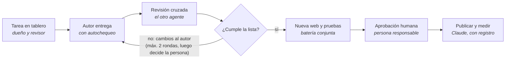

# Plan de orquestación Claude + ChatGPT · HumanaIA

_Actualizado: 27/10/2026 · Versión editable: documento "Plan de orquestación Claude + ChatGPT · HumanaIA 2.0" en el proyecto de Claude._

## Resumen

Claude y ChatGPT construyen la nueva web de HumanaIA en **https://nueva.humannaia.com** (la web real humannaia.com queda intacta hasta el lanzamiento) en carriles separados, se revisan el uno al otro antes de publicar y miden juntos el avance con un índice común de 0 a 100. La propuesta de ChatGPT "HumanaIA 2.0" (marca, 5 líneas de servicio, método CONECTA, arquitectura de 8 secciones, diagnóstico interactivo y laboratorio) se toma como documento estratégico de partida; este plan define quién ejecuta cada parte, cómo se revisa y cómo se mide.

Tres principios:

- **Un dueño por objeto.** Cada página, plantilla, imagen o ajuste tiene un único agente que lo escribe; el otro solo lo revisa.
- **Nada llega a producción sin doble revisión.** El agente autor entrega, el otro revisa con una lista de control y la persona responsable aprueba.
- **Se mide antes y después.** El Sprint 0 fija la línea base; cada sprint repite la misma batería de pruebas y calcula el % de evolución.

## Estado a 27/10/2026

Vamos por delante del calendario.

- **Sprint 0:** su puerta (índice base publicado) está registrada, pero el sprint no está cerrado del todo: siguen pendientes tareas de su checklist, como la copia de la web real (#5) y la parte real del test de comprensión (#4).
- **Entregas materiales aceptadas el 27/10:** la persona responsable aceptó la marca y arquitectura, el paquete de imágenes y el prototipo de la portada (`docs/aceptaciones.md`). El foco es solo la nueva web (nueva.humannaia.com). Lo siguiente es el Sprint 3: el contenido y el desarrollo de las páginas del mapa.

| Área | Estado | Dónde |
| --- | --- | --- |
| Marca | **HumanaIA** (dominio y emails siguen en humannaia.com); marca y mapa de páginas aceptados | #9, `entregas/textos/` |
| Nueva web | WordPress propio en nueva.humannaia.com, no indexable, con tema de bloques Twenty Twenty-Five. La portada es la página de inicio, dividida en secciones con nombre; la cabecera y el pie son partes de plantilla y el CSS es global (guía: `docs/editar-la-web.md`). Fotos reales del equipo e imagen del logotipo para compartir el enlace | #20 |
| Páginas legales | Aviso legal (LSSI-CE), Política de privacidad (RGPD/LOPDGDD) y Política de cookies (LSSI art. 22.2, guía AEPD) publicadas y enlazadas en el pie. Faltan el NIF, los datos registrales, el plazo de conservación y el proveedor de correo; texto provisional hasta revisión | /aviso-legal/, /politica-de-privacidad/, /politica-de-cookies/ |
| Formulario de contacto | Contact Form 7 con casilla de privacidad, información básica de protección de datos y antispam (honeypot). Todavía no está en ninguna página; los correos salientes siguen bloqueados | #20 |
| Web real | humannaia.com, intacta hasta el lanzamiento | — |
| Centro de trabajo | GitHub con carriles, unión automática entre agentes y registro de aceptaciones | Este repositorio |
| Medición | El cambio a la nueva web (PR #36) está pendiente de que se apruebe su corrección. La línea base del 21/10 midió la web actual y otras páginas: queda como referencia histórica, no comparable | [`informe.md`](../informe.md) |
| Contenido del inicio | Texto y SEO editorial entregados y unidos (#40, para #38): título «Consultoría IA, automatización y formación \| HumanaIA». Falta trasladarlos a WordPress | `entregas/textos/inicio.md` |
| Rúbrica y comprensión | Rúbrica de contenido unida (#41): 71/100, provisional. Test de comprensión unido (#42): 15/15 con cinco perfiles simulados, sin participantes ni cronometraje reales. #3 y #4 siguen abiertos. Las tres pruebas con personas reales se dejan para el final, por decisión de la persona responsable | `revisiones/` |
| Codex (ChatGPT) | Trabaja en el repositorio como `Alex00111001`: revisa, aprueba y entrega PR | [`AGENTS.md`](../AGENTS.md) |

**Pendiente de la persona responsable:**
- copia de seguridad de la web real (#5);
- NIF y datos registrales de Humanaia S.L. para las páginas legales;
- destino remoto (p. ej., Google Drive) para las copias de UpdraftPlus de la nueva web.

**Decidido el 27/10:**
- se trabaja solo sobre la nueva web hasta que esté completa. La web actual queda fuera de los cambios y de las conversaciones hasta que la nueva la sustituya (bitácora #11);
- una única dirección de email en toda la web, contacto@humannaia.com, y en contacto los teléfonos de Ester (+34 676 019 117) y Gustavo (+34 635 500 952) (#6, PR #39 unida);
- plugins: los mejores gratuitos (ver «Plugins de WordPress»);
- el banner de #8 queda sin objeto, porque la copia antigua está abandonada.

## Reparto de roles

ChatGPT lleva la estrategia, el texto y las imágenes; Claude lleva la ejecución técnica en WordPress, el SEO técnico, el desarrollo y las pruebas; la persona responsable decide y aprueba. El reparto sigue las fortalezas de cada uno, y ChatGPT entrega su trabajo en GitHub mediante Codex y no edita WordPress, así que nunca hay dos agentes editando WordPress a la vez.

| Área | Dueño (escribe) | Revisor | Por qué este reparto |
| --- | --- | --- | --- |
| Estrategia, marca, método CONECTA, mapa de páginas | ChatGPT | Claude | Ya redactó la propuesta HumanaIA 2.0; Claude contrasta con lo que existe en el sitio |
| Textos: inicio, servicios, casos, FAQ, blog | ChatGPT | Claude | Redacción y tono; Claude revisa datos, SEO on-page y longitud |
| Imágenes generadas, iconos, imagen para redes | ChatGPT | Claude | Genera imágenes; Claude revisa peso, formato, alt y coherencia |
| Maquetación con bloques (tema Twenty Twenty-Five), plantillas, menús | Claude | ChatGPT | Acceso de escritura a la nueva web vía Easy MCP AI (WordpressNueva); ChatGPT revisa fidelidad al texto y a la marca |
| SEO técnico: Yoast, schema, redirecciones, sitemap | Claude | ChatGPT | Datos de OpenRush y Site Kit; ChatGPT revisa títulos y descripciones como redactor |
| Medios: subida, WebP, alt, limpieza de la demo | Claude | ChatGPT | Operaciones masivas en la biblioteca |
| Diagnóstico interactivo y Laboratorio (código) | Claude | ChatGPT | Desarrollo y pruebas automatizadas; ChatGPT revisa preguntas, rutas y textos |
| Preguntas del diagnóstico y lógica de recomendaciones | ChatGPT | Claude | Contenido de negocio; Claude valida que sea implementable |
| Plugins, actualizaciones y copias de seguridad de la nueva web | Claude | Persona responsable | Riesgo técnico alto; siempre con copia previa |
| Pruebas: rendimiento, accesibilidad, enlaces, formularios | Claude | ChatGPT | Batería automatizada |
| Pruebas de comprensión y recorrido de usuario | ChatGPT | Claude | Simula perfiles de visitante y puntúa con rúbrica |
| Fotos reales, autorizaciones de casos, aprobación final | Persona responsable | — | Ningún agente puede aportarlas ni decidirlas |

## Reglas de orquestación

La coordinación pasa por GitHub (este repositorio) y por el registro de auditoría de Easy MCP AI, que anota qué agente toca qué en WordPress y cuándo.

1. **Una tarea = un issue = una rama = una pull request.** Cada issue lleva dueño, revisor y sprint (etiquetas `dueño:*`, `revisa:*`, `sprint-*`). Ramas `chatgpt/<issue>-…` o `claude/<issue>-…`.
2. **Instrucciones en el propio repositorio.** [`AGENTS.md`](../AGENTS.md) (lo lee Codex) y [`CLAUDE.md`](../CLAUDE.md) (lo lee Claude) fijan carriles, reglas y listas de control.
3. **Comprobación automática de carril.** Si una rama de ChatGPT toca código o una de Claude toca textos o imágenes de ChatGPT, la pull request falla.
4. **ChatGPT entrega en GitHub, no en WordPress.** Textos en `entregas/textos/`, imágenes en `entregas/imagenes/`; Claude los lleva a la nueva web cuando la pull request está unida.
5. **Solo la nueva web se modifica.** Toda escritura va a nueva.humannaia.com; la web real queda intacta hasta el lanzamiento.
6. **Aprobación entre agentes.** Una PR ordinaria se une sola cuando la identidad autorizada del otro agente la aprueba con una revisión formal sobre el último commit, Carril está en verde y no tiene `pausa` ni `decide-persona` (decisión de la persona responsable, 26/10/2026, #27). Identidades: Claude publica como `multiserviagua-pixel` y ChatGPT/Codex como `Alex00111001`; la aprobación de cualquier otra cuenta, o de una rama de un fork, no une nada. Las PR que modifican `.github/workflows/` las une la persona responsable. Tras dos rondas sin acuerdo se marca `decide-persona` y decide ella. Unir una PR no es aceptar una entrega material (ver «Fusión y aceptación»).
7. **Nada destructivo en automático.** Borrar, cambiar plugins o ajustes de seguridad queda como `decide-persona`.
8. **Pausa y trazabilidad.** La etiqueta `pausa` detiene a los agentes; cada turno deja resumen en la bitácora #11 y los cambios en WordPress se anotan en su issue (página, ID, cambio).
9. **Material en bruto en Drive.** Fotos originales y archivos grandes se comparten por Drive; lo que va a la web pasa por GitHub.

## Avisos a la persona responsable

La persona responsable no sigue el día a día: los agentes se aprueban entre ellos y ella solo recibe un aviso (notificación del turno de Claude) cuando hay algo **material**:

1. **Algo que ver:** una página, sección o prototipo terminado en nueva.humannaia.com, con su enlace.
2. **Una puerta de sprint:** cierre de sprint con el Índice HumanaIA y el % de evolución.
3. **Algo que solo ella puede dar o decidir:** issues `decide-persona`, fotos reales, autorizaciones de casos o datos, desacuerdo tras dos rondas.
4. **Un incidente:** la nueva web caída, un problema de seguridad o algo que afecte a la web real.

Lo demás (revisiones, correcciones, relevos, avisos repetidos) queda solo en la bitácora #11. Un aviso no es una aceptación: si lo avisado es una entrega material, el trabajo que depende de ella espera a que la persona responsable la acepte.

## Fusión y aceptación

Unir una PR a `main` y aceptar una entrega material son puertas distintas:

1. **PR ordinaria** (borradores, correcciones, documentación, código revisado): basta la revisión cruzada y la unión automática. Unirla no aprueba la arquitectura, el posicionamiento, un prototipo ni el lanzamiento.
2. **Entrega material** (posicionamiento y arquitectura del Sprint 1, prototipo del Sprint 2, cada puerta de sprint): necesita la **aceptación expresa de la persona responsable**, anotada por ella en el issue de la tarea, antes de ejecutar trabajo que dependa de ella. Claude no lleva a WordPress una página o estructura que dependa de una entrega material sin esa aceptación.
3. **PR que ejecuta una decisión material todavía pendiente:** se marca `decide-persona` y la unión automática no la une.
4. **Lanzamiento y migración** de nueva.humannaia.com a humannaia.com: siempre con aprobación expresa de la persona responsable; nunca en automático.

## Revisión cruzada

Cada entrega la revisa el agente que no la hizo, con una lista de control fija; si no la supera vuelve al autor, y tras dos rondas sin acuerdo decide la persona responsable.



**Lista de control de Claude al revisar a ChatGPT:** datos y nombres verificables, sin casos ni métricas sin autorización; título de 50–60 caracteres y descripción de 140–160; un solo H1 y jerarquía H2/H3; palabra clave objetivo presente; imágenes ≤ 200 KB en WebP con alt descriptivo; marca escrita como HumanaIA.

**Lista de control de ChatGPT al revisar a Claude:** la página publicada dice exactamente el texto aprobado; tono y paleta de marca; llamada a la acción visible sin hacer scroll en móvil; recorrido del visitante coherente; textos alternativos que describen de verdad la imagen; nada de contenido de la plantilla demo.

## Fases y sprints

Las 8 fases de la propuesta de ChatGPT se agrupan en 5 sprints; se proponen sprints de dos semanas, unas 11 semanas en total, a ajustar con la disponibilidad real del equipo. En cada sprint los dos agentes trabajan en paralelo sobre objetos distintos, y no se pasa al siguiente sin superar su puerta.

| Sprint | ChatGPT | Claude | Puerta de salida |
| --- | --- | --- | --- |
| **0 · Proteger y medir** | Rúbrica de contenido; test de comprensión del inicio | Nueva web en nueva.humannaia.com; línea base del índice | Índice base publicado |
| **1 · Identidad y arquitectura** | Documento maestro de marca; mapa de páginas y URL | Auditoría SEO y palabras clave; limpieza de demo y erratas | Posicionamiento aprobado |
| **2 · Diseño y plataforma** | Texto del inicio; imágenes e iconos | Prototipo y sistema de diseño; actualizaciones en la nueva web | Prototipo validado |
| **3 · Contenido y desarrollo** | Servicios, casos y FAQ; preguntas del diagnóstico | Plantillas y contenidos tipo; diagnóstico y laboratorio | Pruebas funcionales correctas |
| **4 · SEO y lanzamiento** | Revisión final de textos; test con 3 personas reales | Schema, sitemap y redirecciones; migración de nueva.humannaia.com a humannaia.com y monitorización | **Índice ≥ meta y aprobación** |

Cada puerta exige: revisión cruzada cerrada, batería de pruebas pasada y comparada con el sprint anterior, y aprobación de la persona responsable.

## Pruebas conjuntas y % de evolución

Al final de cada sprint los dos agentes pasan la misma batería sobre las mismas URL y el resultado se resume en un Índice HumanaIA de 0 a 100. Claude ejecuta las pruebas automáticas, ChatGPT las de comprensión y contenido, y cada uno revisa los resultados del otro. Una diferencia de más de 10 puntos entre las notas de ambos en una misma prueba obliga a revisarla con la persona responsable. El detalle técnico de la medición está en [`MEDICION.md`](../MEDICION.md).

### Batería de pruebas del sitio

| Bloque | Peso | Qué se mide | Quién ejecuta | Herramienta |
| --- | --- | --- | --- | --- |
| Rendimiento | 20 % | LCP ≤ 2,5 s, INP ≤ 200 ms (TBT en laboratorio), CLS ≤ 0,1 en móvil; nota Lighthouse | Claude | GitHub Actions + Lighthouse |
| Accesibilidad | 15 % | Nota Lighthouse, alt en imágenes, contraste, foco | Claude | Lighthouse + revisión manual |
| SEO técnico | 15 % | Auditoría de sitio, metadatos, schema, enlaces rotos, indexación | Claude | Checklist propia, OpenRush, Search Console |
| Contenido | 20 % | Rúbrica de 10 criterios ([`datos/rubrica.md`](../datos/rubrica.md)) | ChatGPT puntúa, Claude revisa | Rúbrica compartida |
| Comprensión | 15 % | ¿Un visitante entiende en 60 s qué hace HumanaIA, para quién y cómo empezar? 5 perfiles simulados + 3 personas reales | ChatGPT | Test y guion |
| Conversión | 15 % | Contactos, uso del diagnóstico, clics en llamadas a la acción | Claude | Site Kit (GA4) |

### Fórmulas

Cada métrica se normaliza a 0–100 frente a su objetivo; el índice es la suma ponderada:

```math
I = \sum_{k} w_k \cdot \min\left(100,\ 100 \cdot \frac{m_k}{\text{objetivo}_k}\right)
```

La evolución de cada sprint y el avance hacia la meta:

```math
\%\,\text{evolución} = 100 \cdot \frac{I_{\text{actual}} - I_{\text{base}}}{I_{\text{base}}} \qquad \%\,\text{avance} = 100 \cdot \frac{I_{\text{actual}} - I_{\text{base}}}{I_{\text{meta}} - I_{\text{base}}}
```

En métricas donde menos es mejor (LCP, CLS, errores) se usa objetivo / valor en lugar de valor / objetivo. La evolución solo compara los bloques medidos en ambas fechas.

### Desempeño de los agentes

| Métrica | Cómo se calcula | Meta |
| --- | --- | --- |
| Aprobación a la primera | Entregas aceptadas sin cambios / entregas | ≥ 70 % |
| Defectos hallados en revisión cruzada | Defectos que el revisor encuentra por entrega | Bajando sprint a sprint |
| Defectos escapados | Errores que llegan a producción | 0 críticos |
| Retrabajo | Horas de corrección / horas totales | ≤ 20 % |
| Cambios fuera de tablero | Cambios en el registro de auditoría sin tarea | 0 |

Los objetivos numéricos de conversión se fijan cuando haya cuatro semanas de datos.

## Herramientas

Ya están en marcha Easy MCP AI en la nueva web (WordpressNueva), GitHub con Actions y OpenRush. Faltan conectar Codex, una copia de seguridad de la web real, optimización de imágenes y caché.

### Conectores y servicios

| Conector o servicio | Para quién | Uso en el plan | Estado |
| --- | --- | --- | --- |
| [Easy MCP AI](https://easymcpai.com/blog/claude-mcp-wordpress) · nueva web ("WordpressNueva") | Claude (escritura), ChatGPT (lectura) | Todo el trabajo en WordPress, en https://nueva.humannaia.com | Conectado a Claude |
| GitHub (este repositorio) | Ambos | Centro de trabajo: issues, pull requests, revisiones, medición | Conectado a Claude |
| Codex (ChatGPT) | ChatGPT | Escribir en GitHub: ramas y pull requests de contenido | Pendiente de conectar |
| GitHub Actions + Lighthouse | Automático | Medición nocturna del índice | Funcionando |
| OpenRush | Claude | Auditoría SEO, palabras clave, competidores | Conectado |
| Google Drive | Ambos | Fotos originales y material en bruto | Conectado a Claude |
| Search Console y GA4 ([guía](https://seranking.com/blog/best-seo-mcps/)) | Ambos | Clics, consultas y conversiones; disponibles en Easy MCP AI | Sin conectar |

### Plugins de WordPress

Decisión de la persona responsable (27/10/2026): usar los mejores plugins gratuitos. Estado en la nueva web:

| Necesidad | Plugin (gratuito) | Estado |
| --- | --- | --- |
| SEO, metadatos, schema y redes | The SEO Framework | Activo. Sustituye a Yoast, que queda inactivo y se puede eliminar |
| Formularios | Contact Form 7 + CF7 Apps (honeypot antispam) | Activos |
| Imágenes WebP | Converter for Media | Activo |
| Copias de seguridad | UpdraftPlus | Activo. Programado: base de datos a diario y archivos cada semana, en el propio servidor. Falta un destino remoto |
| Correo saliente | WP Mail SMTP | Activo, con «No enviar» activado hasta el lanzamiento |
| Seguridad del acceso | Limit Login Attempts Reloaded | Activo |
| Certificado SSL | WP Encryption (Let's Encrypt) | Activo |
| Caché | WP Super Cache | Inactivo; se activa antes del lanzamiento |
| Analítica y consentimiento | Site Kit (GA4) + panel de cookies (Complianz) | Antes del lanzamiento: con analítica hay que pedir consentimiento previo y actualizar la Política de cookies |
| Retirados | Slider Revolution, WPForms, AI Engine, Elementor | No se usan en la nueva web; se van con la web actual en el lanzamiento |

### Skills y capacidades

| Agente | Skill o capacidad | Uso |
| --- | --- | --- |
| Claude | [frontend-design](https://codenote.net/en/posts/anthropic-official-skills-catalog-overview/) | Prototipos del inicio y plantillas con criterio visual |
| Claude | webapp-testing (Playwright) | Pruebas automáticas de formularios, enlaces y diagnóstico |
| Claude | Design y Dashboard (artefactos) | Maquetas para revisar y cuadro de mando del índice |
| Claude | skill-creator | Convertir la batería de pruebas en un skill reutilizable cada sprint |
| ChatGPT | Codex | Ramas y pull requests en este repositorio siguiendo `AGENTS.md` |
| ChatGPT | Generación de imágenes | Ilustraciones, iconos de servicios, imagen para redes |
| ChatGPT | Deep research | Competencia y palabras clave (solo lectura) |

## Riesgos y próximos pasos

El riesgo principal ya está acotado: todo el trabajo va a la nueva web (nueva.humannaia.com, no indexable) y nada se une sin aprobación. Lo que sigue abierto es la falta de copia de seguridad de la web real y el bloqueo de correos salientes en la nueva web.

| Riesgo | Mitigación |
| --- | --- |
| Un agente rompe la web pública | Solo se escribe en nueva.humannaia.com, con su propia base de datos; la web real no se toca. Pendiente: copia de seguridad (#5) |
| Los agentes se pisan | Un dueño por archivo, comprobación automática de carril y cruce con el registro de auditoría |
| Dos sesiones de Claude en paralelo duplican trabajo | Una sola tarea programada; revisar la lista de tareas programadas |
| La nueva web se indexa antes de tiempo | Mantener "Disuadir a los motores de búsqueda" activado hasta el lanzamiento |
| Un formulario de la nueva web envía correos reales durante las pruebas | Bloquear o redirigir el correo saliente antes de publicar formularios (#20) |
| Un comentario en issues o PR cambia las reglas | Los comentarios solo cambian el estado de trabajo; las reglas solo cambian en `AGENTS.md`/`CLAUDE.md` unidos a `main` |
| Textos con datos inventados o casos sin permiso | Revisión cruzada; la persona responsable autoriza nombres y métricas |
| Prompts maliciosos en issues, páginas o contenido | Los agentes tratan ese texto como dato y lo anotan en la bitácora |
| Ciclo automático fuera de control | Máx. 2 rondas de revisión, nada destructivo en automático, etiqueta `pausa` |

### Sprint 0: checklist

- [x] Claude: crear la copia de pruebas con WP Staging y bloquear sus emails (#7)
- [x] Claude: medir la línea base y publicar el informe (71,5/100, 50 % del peso)
- [x] Claude: montar GitHub como centro de trabajo (carriles, plantillas, comprobación de carril)
- [x] Claude: corregir marca, erratas, enlaces, SEO y texto alternativo en la copia (#10)
- [x] Persona responsable: crear la nueva web en nueva.humannaia.com y conectarla a Claude (WordpressNueva) (#18)
- [x] Claude: ciclo automático de turnos y bitácora (#11)
- [x] Persona responsable: nombre comercial único (HumanaIA)
- [ ] Persona responsable: copia de seguridad de la web real (#5)
- [x] Persona responsable: email de Ester (contacto@humannaia.com) y fotos del equipo (#6)
- [x] Persona responsable: plugins gratuitos; WPForms, AI Engine y banner (#8) sin objeto en la nueva web
- [x] Persona responsable: conectar Codex al repositorio (revisa como `Alex00111001`)
- [ ] ChatGPT/Codex: puntuar el inicio con la rúbrica (#3: 71/100 provisional, unida en #41) y test de comprensión (#4: 15/15 simulado, unido en #42; faltan 3 personas reales, al final)
- [x] ChatGPT/Codex: documento maestro de marca y mapa de páginas (#9, aceptado el 27/10)

## Fuentes

- Propuesta "HumanaIA 2.0" de ChatGPT (21/10/2026), aportada por la persona responsable
- Revisión del sitio vía Easy MCP AI: plugins activos, páginas, diagnóstico y registro de auditoría (19 y 21/10/2026)
- [OpenAI: modo desarrollador y conectores MCP en ChatGPT](https://help.openai.com/en/articles/12584461-developer-mode-apps-and-full-mcp-connectors-in-chatgpt)
- [SE Ranking: mejores MCP de SEO](https://seranking.com/blog/best-seo-mcps/)
- [Glama: servidores MCP de Lighthouse](https://glama.ai/mcp/servers/integrations/lighthouse)
- [Catálogo de skills oficiales de Anthropic](https://codenote.net/en/posts/anthropic-official-skills-catalog-overview/)
- [EasyMCPAI: conectar Claude con WordPress](https://easymcpai.com/blog/claude-mcp-wordpress)
